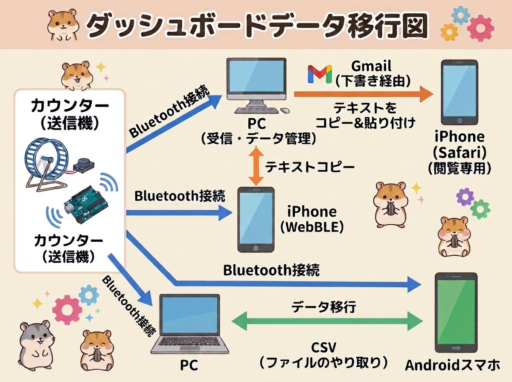

回し車＆体重 マルチダッシュボード 取扱説明書

アクセスURL: https://puaratchada-commits.github.io/wheel-counter/

本WEBアプリは、複数匹のハムスターの回し車運動データ（回転数、速度、運動時間）および日々の体重を、

Bluetooth通信で取得・一元管理するための専用ダッシュボードです。

1. 初期設定とBluetooth接続

ご利用の端末に合わせてダッシュボードを開き、回し車（送信機）と接続します。

PC・Androidの場合:
Google Chrome または Microsoft Edgeでアクセスしてください。

iPhoneの場合:
iOSの仕様上、標準のSafariやChromeではBluetooth通信ができません。

必ずApp Storeから「WebBLE」（有料300円）のブラウザアプリをインストールし、

そこからアクセスしてください。

接続手順

ダッシュボード上部の「Bluetooth 接続」ボタンを押します。

周辺の機器リストから、対象の送信機（例: BT05 等）を選択します。

接続成功後、「この個体の名前（表示名）を入力してください」というダイアログが出たら、

ハムスターの名前（例: モモ）を入力して「OK」を押します（次回以降は自動で紐づきます）。

2. 画面の見方と基本操作

上部の「表示する個体」プルダウンから、確認したいハムスターの名前を選択するとデータが切り替わります。

日付ごとの推移グラフ:

過去50件の推移を表示します。「全体棒グラフの対象」を変更することで、

運動時間や回転数など強調したい項目を切り替えられます。

24時間分布グラフ:

お昼12:00から翌日11:00までの時間帯別アクティビティを表示し、

夜間の活動ピークが一目で分かります。

選択個体・日の確定データ:

グラフの特定の点をクリックするか日付を指定すると、

その日の詳細な数値が表示されます。

本体累計記録:

これまでの「累計回転数」と「累計走行距離（m / km）」を自動計算して表示します。

3. 体重の記録

カレンダーから入力したい日付を選択し、「今日の体重 (g):」の入力欄に数値（例: 35.2）を入力して

「体重を保存」ボタンを押します。

回し車の運動データと重ねてグラフ化され、トレンドが視覚的に確認できます。

4. データのバックアップと移行

データはブラウザ内に保存されるため、定期的な外部バックアップや、端末変更時のデータ移行機能が備わっています。

データの保存（エクスポート）

PC・Android:
「選択個体CSV保存」または「全個体CSV保存」を押し、CSVファイルとして端末にダウンロードします。

iPhone (WebBLE等):
アプリの仕様でファイル保存がブロックされる場合は「テキストをコピー」機能を使い、

Gmailの「下書き」やLINEの「Keepメモ」などにペーストして安全に保管してください。

データの読み込み（インポート）

ファイルから読み込む:
「ファイル選択」から保存済みのCSVファイルを選びます。

複数個体のデータが混ざっていても、アプリが自動で対象の枠に振り分けます。

テキストから読み込む:

保管した文字データを全選択・コピーし、

「＋ テキストを貼り付けてインポート」ボタンから専用枠に貼り付けて実行します。

運用はAndroidスマホで行う、iPhoneで行う、PCで行う、スマホとPC両方で行う

以上の選択肢があります。どれでカウンターからのBluetoothデータを受信するか

データをどう転送するかは以下の図を参照して下さい。

5. データの消去

「表示する個体」のプルダウンから消去したい名前を確実に選択し、

赤文字の「データ全消去」ボタンを押すことで、選択中の個体データのみが完全に初期化されます。

6. ご利用上の注意点

iPhoneでのバックグラウンド動作制限:

WebBLE等を使用してデータを受信している最中は、画面をスリープさせたり、

別のアプリを長時間開いたりしないでください。

iOSの制限によりBluetooth通信が強制的に遮断されるため、

計測中は画面を点灯させたままにしておく必要があります。

ブラウザのキャッシュについて:

ブラウザの履歴やキャッシュを完全に削除すると、保存されたローカルデータも初期化されてしまいます。

大切な記録は定期的にCSVまたはテキストでバックアップを取るようにしてください。
