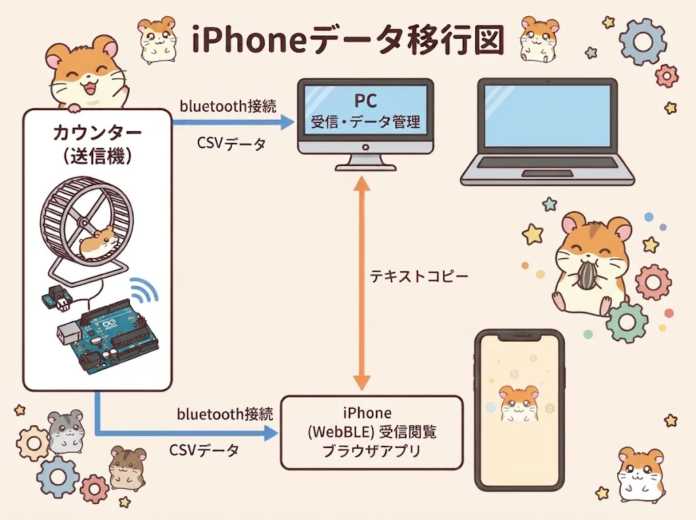
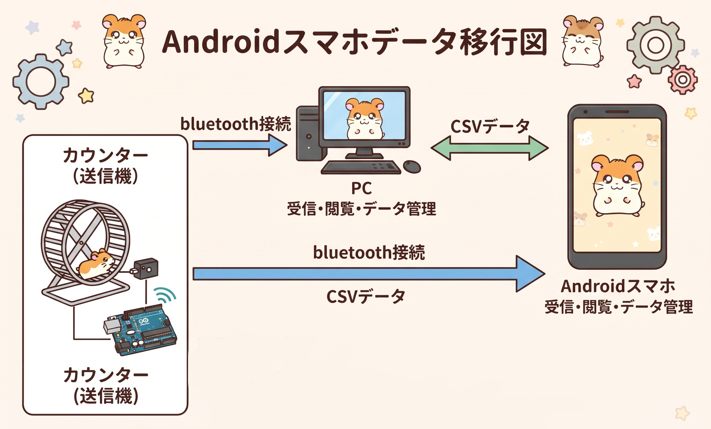

# 🐹 回し車＆体重 マルチダッシュボード 使い方ガイド

GIGI回し車カウンターをご利用いただきありがとうございます！
このページ（ダッシュボード）では、ハムちゃんたちの毎日の運動データ（回転数、スピード、走った時間）や体重を、スマホやパソコンから簡単に確認・記録できます✨

👉 **ダッシュボードへのアクセスはこちら**
[https://puaratchada-commits.github.io/wheel-counter/](https://puaratchada-commits.github.io/wheel-counter/)

---

### 📱 ご利用にあたって（スマホ・PCの準備）

お使いの端末によって、使用するインターネットブラウザが異なります。

* **Androidスマホ・パソコンの方**
いつもの「Google Chrome」または「Microsoft Edge」でそのままお使いいただけます！
* **iPhoneの方**
iPhone標準の「Safari」や「Chrome」は、Appleの仕様でBluetoothに繋ぐことができません💦
お手数ですが、App Storeから「WebBLE」という専用ブラウザアプリ（買い切り300円）をインストールしてご利用ください。

**👇 iPhoneでのご利用イメージ**

**👇 Androidでのご利用イメージ**

---

### 🔌 １. ハムちゃんと繋いでみよう（Bluetooth接続）

1. ダッシュボード画面の上にある「Bluetooth 接続」ボタンをポチッと押します。
2. 近くの機器リスト（例：GIGI-06など）が出てくるので、繋ぎたい送信機を選びます。
3. うまく繋がると「この個体の名前を入力してください」と聞かれます。「モモちゃん」など、ハムちゃんのお名前を入れて「OK」を押してくださいね（次回からは自動で繋がります💡）。

### 📊 ２. グラフの見方と便利機能

画面上の「表示する個体」メニューから見たいハムちゃんのお名前を選ぶと、パッとデータが切り替わります。

* **日付ごとの推移グラフ**
回転数や体重などの変化がひと目でわかります。「運動時間だけ棒グラフにする」といったカスタマイズや、見たい項目だけの表示も可能です（データは最大10,000日分保存でき、グラフには直近の50件を表示します）。
* **24時間分布グラフ**
お昼12:00〜翌日11:00までの活動リズムがわかります。「夜中の何時によく走っているかな？」がチェックできて楽しいですよ🌙
* **その日のくわしい記録（確定データ）**
グラフの点をタップするか、カレンダーで日付を選ぶと、その日の詳細な数字が表示されます。
* **本体累計記録**
使い始めてからの「トータル回転数」と「走った距離（m / km）」を自動で計算してお知らせします🐾

### ⚖️ ３. 体重を記録しよう

カレンダーから記録したい日を選び、「今日の体重 (g):」の欄に数字（例：166）を入れて「体重を保存」ボタンを押すだけ！
回し車の運動データと一緒にグラフになるので、運動量と体重のバランスを見るのにとても便利です。

### 💾 ４. 大切なデータの保存と引き継ぎ（バックアップ）

データはスマホやPCの中に保存されています。機種変更のときや、万が一に備えて、定期的にバックアップを取ることをおすすめします。

**【データを保存するとき】**

* **PC・Android:** 「選択個体CSV保存」ボタンを押すと、ファイルとしてサクッとダウンロードできます。
* **iPhone:** iPhoneの制限でファイル保存ができないため、「テキストをコピー」ボタンを押して、文字データをGmailの下書きやLINEの「Keepメモ」などに貼り付けて（ペーストして）保管してください📝

**【データを復元するとき】**

* **ファイルから:** 「ファイル選択」から、保存しておいたCSVファイルを選ぶだけで元通り！
* **テキストから:** 保管しておいた文字データをすべてコピーし、「＋ テキストを貼り付けてインポート」から専用の枠に貼り付ければOKです。
* ※複数のハムちゃんのデータが混ざっていても、賢く自動で振り分けます✨

### 🗑️ ５. データの消去について

メニューから消したいハムちゃんのお名前を確実に選び、赤文字の「データ全消去」ボタンを押すと、その子のデータだけをリセットできます（間違えて消さないように気をつけてくださいね！）。

### ⚠️ ６. ご利用上の注意点（大切なお願い）

* **iPhoneをご利用の方へ（画面スリープに注意）**
WebBLEアプリでデータを受信している間は、画面を暗くしたり（スリープ）、別のアプリを長時間開いたりしないでください。iPhoneの仕組み上、Bluetooth通信が切れてしまいます💦 計測中は画面をつけたままにしておいてくださいね。
* **履歴の削除（キャッシュクリア）について**
スマホやPCの「閲覧履歴・キャッシュ」を完全に消去すると、一緒にダッシュボードのデータもリセットされてしまいます。大切な記録が消えないよう、こまめにバックアップ（保存）を取っておくと安心です。
